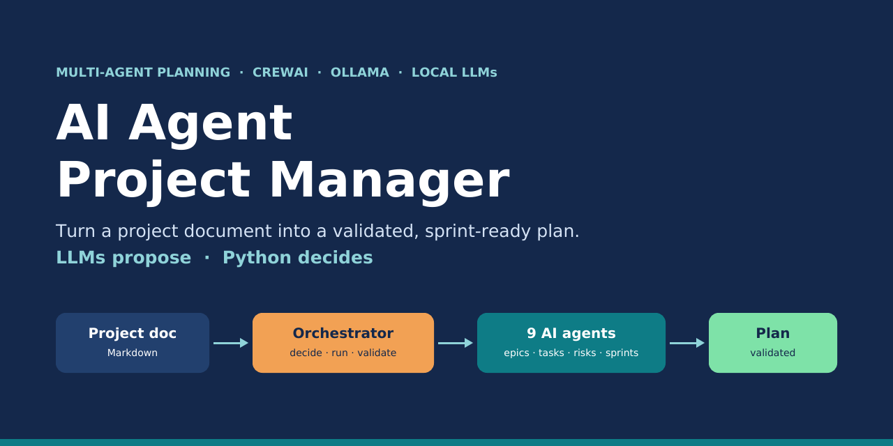
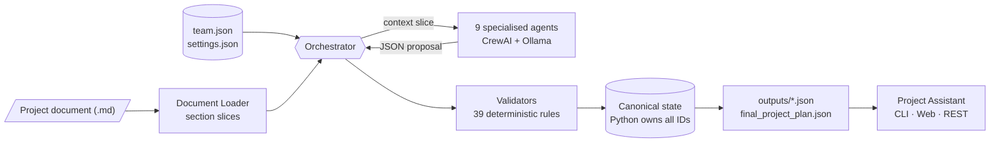
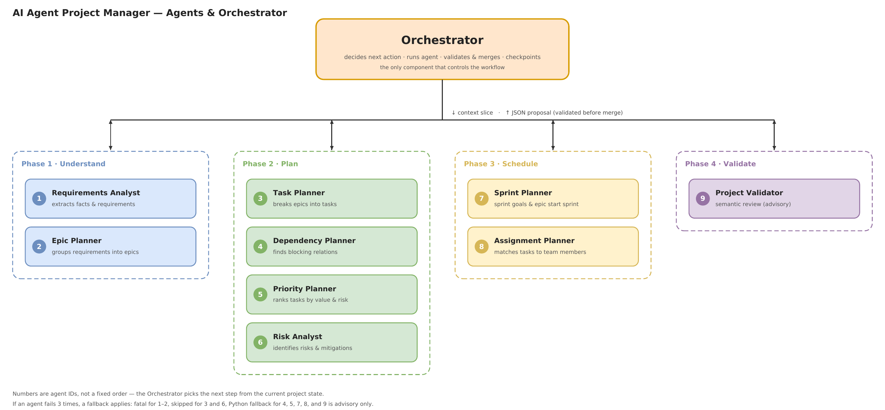
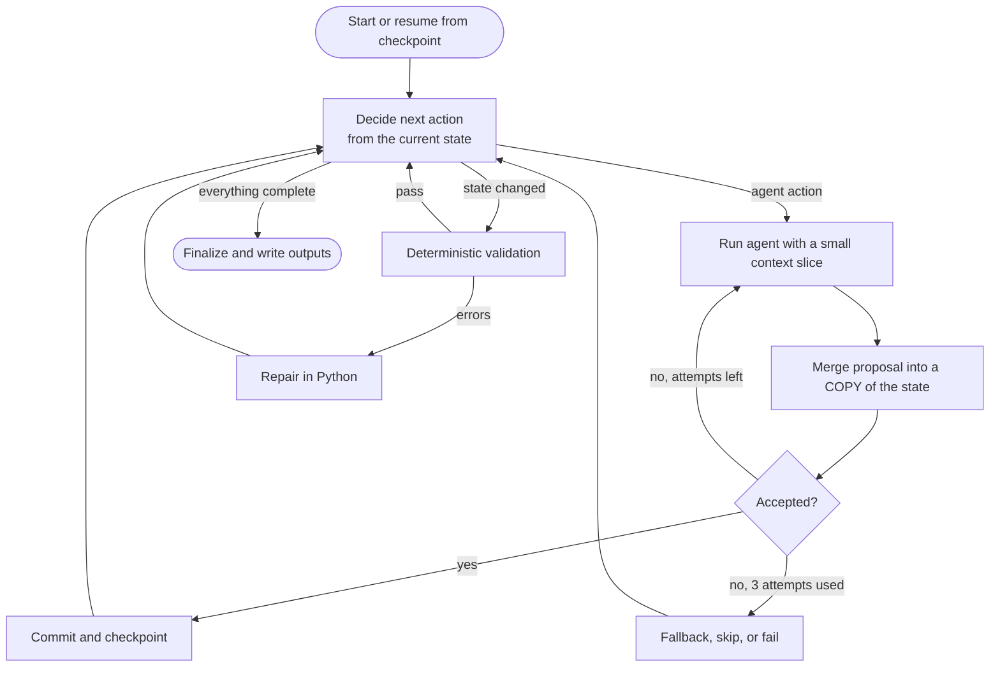
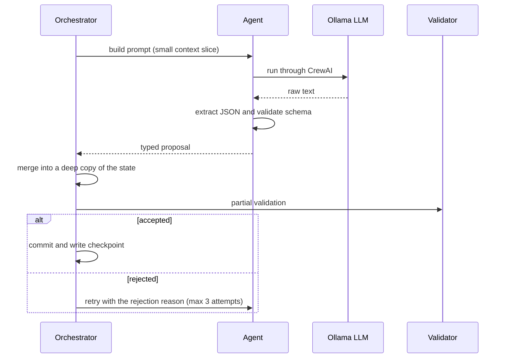

<div align="center">



# AI Agent Project Manager

**A multi-agent system that reads a project document and produces a validated, sprint-ready delivery plan.**
Built with [CrewAI](https://github.com/crewAIInc/crewAI) and local LLMs served by [Ollama](https://ollama.com): your project data never leaves your machine.

[](https://github.com/YOUR_USERNAME/ai-agent-project-manager/actions/workflows/ci.yml)


-black)


[](LICENSE)

[Overview](#overview) ·
[Architecture](#architecture) ·
[The agents](#the-agents) ·
[Orchestrator](#how-the-orchestrator-works) ·
[Quick start](#quick-start) ·
[Results](#results) ·
[Docs](#documentation)

</div>

---

## Overview

Turning a project brief into an executable plan is repetitive work: extract requirements, group them into epics, estimate tasks, find blockers, balance workload, and make sure nothing is inconsistent. This project automates it.

**Input:** a Markdown project document (with `##` sections) and a team definition (`config/team.json`).
**Output:** requirements, epics, tasks with hour estimates, dependencies, priorities, risks, a sprint schedule, milestones and per-member assignments, all checked by 39 deterministic validation rules.

> ### Core principle: *LLMs propose, Python decides*
> Agents never touch the project state. Each one receives a small slice of context and returns a **strictly-typed proposal**. All IDs, scheduling, capacity limits, role matching and validation are done by deterministic Python code. That is what keeps the result reliable even with small (3B–7B) local models.

### Highlights

- **9 specialised agents**, each with its own role, prompt and output schema.
- **State-driven Orchestrator** that decides the next action from the current project state (not from a fixed script).
- **Transactional updates:** every proposal is merged into a copy of the state, validated, and only then committed.
- **Self-healing:** retry with the exact rejection reason, per-step deterministic fallbacks, loop guards, checkpoint and `--resume`.
- **Authoritative validation:** 39 rule codes gate completion; the LLM semantic review is advisory only.
- **Fully local:** Ollama + open models, no external API calls.
- **Project Assistant:** a scoped Q&A chatbot (CLI, web page, REST API) that answers only from the generated plan, in English or Arabic.
- **Offline test suite and mock LLM** so CI runs without a GPU or model download.

---

## Architecture





*Editable source: [`docs/assets/agents-orchestrator-diagram.drawio`](docs/assets/agents-orchestrator-diagram.drawio) (open with [draw.io](https://app.diagrams.net)).*

---

## The agents

| # | Agent | Role | Used for | If it fails |
|---|-------|------|----------|-------------|
| 1 | **Requirements Analyst** | Extracts project facts and functional / non-functional requirements | `analyze_project`, `extract_requirements` | Fatal |
| 2 | **Epic Planner** | Groups requirements into 5–8 delivery epics | `create_epics` | Fatal |
| 3 | **Task Planner** | Breaks epics into small tasks (2–16 h); fills gaps such as missing QA or design | `create_tasks` | Skipped, repaired later |
| 4 | **Dependency Planner** | Finds real blocking relations between tasks | `create_dependencies` | Python heuristic fallback |
| 5 | **Priority Planner** | Ranks tasks critical → low to protect the MVP | `set_priorities` | Default priorities |
| 6 | **Risk Analyst** | Identifies 5–8 delivery risks with mitigations | `detect_risks` | Skipped |
| 7 | **Sprint Planner** | Sprint goals, milestone names, epic start sprints | `plan_sprints` | Python-only planning |
| 8 | **Team Assignment Planner** | Best-fit member per task when several share a role | `assign_tasks` | Least-loaded assignment |
| 9 | **Project Validator** | Semantic review of the finished plan (advisory) | `semantic_review` | Skipped |

Deterministic Python handles everything that must be *correct* rather than *creative*: the sprint scheduler, task assignment, heuristic dependencies, the 39-rule validator and the automatic repair step. See [docs/agents.md](docs/agents.md) for full profiles.


---

## How the Orchestrator works

The Orchestrator is a loop: **inspect state → decide next action → run agent → validate → merge → repeat**. Completion is gated by a full deterministic validation.



One agent call in detail:



| Guard | Setting | Default |
|-------|---------|---------|
| Max loop iterations | `max_iterations` | 80 |
| Max times one action may be selected | `max_action_rounds` | 6 |
| Attempts per agent call | `max_agent_attempts` | 3 |
| Repair rounds after failed validation | `max_repair_rounds` | 2 |
| LLM timeout per call | `llm_timeout_seconds` | 300 s |

More detail: [docs/orchestrator.md](docs/orchestrator.md) · [docs/validation.md](docs/validation.md).

---

## Quick start

### Requirements

- Python 3.11
- [Ollama](https://ollama.com/download) with a model pulled (only for real runs; the mock mode needs no Ollama)

### Install

```bash
git clone https://github.com/YOUR_USERNAME/ai-agent-project-manager.git
cd ai-agent-project-manager
python -m venv .venv && source .venv/bin/activate     # Windows: .venv\Scripts\activate
pip install -r requirements.txt
```

### 1. Smoke test, offline (no LLM)

```bash
python main.py --test --mock
```

Runs the whole pipeline against the bundled sample document with a mock LLM and verifies that all 11 expected output files exist and validation passes.

### 2. Plan a real project with a local model

```bash
ollama pull qwen2.5:7b-instruct
python main.py --doc examples/inputs/clinic_project.md --model qwen2.5:7b-instruct
```

Results are written to `outputs/` (see [Output files](#output-files)). If a run is interrupted, continue from the last checkpoint:

```bash
python main.py --doc examples/inputs/clinic_project.md --resume
```

### CLI reference

| Flag | Description |
|------|-------------|
| `--doc PATH` | Project documentation (Markdown with `##` sections) |
| `--test` | Run on the bundled sample document and verify all outputs |
| `--mock` | Use the offline mock LLM (no Ollama needed) |
| `--resume` | Continue from `outputs/state_checkpoint.json` (same document only) |
| `--model NAME` | Override the Ollama model |
| `--output-dir DIR` | Override the output directory |

Exit codes: `0` plan complete and validated · `1` runtime or infrastructure error · `2` validation failed · `130` interrupted.

### Write your own project document

Use `##` headings such as *Overview, Objectives, Scope, Out of Scope, Users, Functional Requirements, Non-Functional Requirements, Constraints, Team, Timeline, Milestones, Dependencies, Risks, MVP Definition*. See [`examples/inputs/`](examples/inputs) for two complete examples. Describe your team in [`config/team.json`](config/team.json) (roles, skills, weekly capacity).

---

## Output files

| File | Content |
|------|---------|
| `final_project_plan.json` | The complete validated plan (or `draft_project_plan.json` if validation failed) |
| `requirements / epics / tasks / dependencies / priorities / sprints / assignments / risks .json` | One file per entity type |
| `validation.json` | Pass/fail, issue list, semantic verdict and notes |
| `execution_log.json` | Every orchestrator step: action, agent, status, seconds, state revision |
| `state_checkpoint.json` | Full state snapshot for `--resume` |
| `run.log` | Human-readable log |

Real outputs are included in [`examples/outputs/`](examples/outputs).

---

## Results

The pipeline was run on two sample projects. All numbers below come from the execution logs and plan files in [`examples/outputs`](examples/outputs).

| | Support platform (7B) | Support platform (3B)¹ | Clinic system (7B) |
|---|---|---|---|
| Planning time | 3,542 s (≈ 59 min) | 59 s | 1,088 s (≈ 18 min) |
| LLM calls | 24 | 8 | 24 |
| Tasks · hours | 48 · 344 h² | 27 · 166 h | 48 · 318 h |
| Dependencies | 30 | 1 | 45 |
| Validation | pass · 0 errors | pass · 0 errors | pass · 0 errors · 4 warnings |

<sub>¹ Resumed from a checkpoint. ² Derived from the sprint summary in the archived execution log.</sub>


**Clinic Appointment & Patient Management System** (4-week MVP): 35 requirements, 8 epics, 48 tasks, 45 dependencies, 5 risks, 4 sprints, 4 milestones.

| Sprint load | Team workload |
|:---:|:---:|
|  |  |

| Task mix | Effort per epic |
|:---:|:---:|
|  |  |


Takeaways:
- **Model size matters for relational reasoning:** on the same document the 7B model found 30 dependencies versus 1 for the 3B model. 3B is good for smoke tests and fast iteration.
- **The retry loop works in practice:** the Dependency Planner hit two 300 s timeouts and then succeeded; the Sprint Planner returned invalid JSON twice and was accepted on the third attempt.
- **Dependency analysis dominates run time** on 7B (≈ 180 s in the clinic run).

Full details and caveats: [docs/results.md](docs/results.md).

---

## Project Assistant

Once a plan exists, ask questions such as *"Who owns TASK-012?"* or *"What is in sprint 3?"* (Arabic works too). The assistant answers **only from the generated plan** and politely refuses unrelated questions, using three guard layers: a deterministic ID/keyword check, a tiny YES/NO classifier call, and an out-of-scope instruction in the answer prompt.

```bash
python chat.py --plan examples/outputs/clinic_7b/final_project_plan.json --model qwen2.5:7b      # CLI
uvicorn server:app --host 0.0.0.0 --port 8000                                                    # web page + REST API
```

REST: `GET /health` · `POST /ask` with `{"question": "...", "session_id": "..."}`. Optional API key through the `x-api-key` header.

---

## Docker

`docker-compose.prod.yml` starts Ollama and the web app on one server.

```bash
cp .env.example .env                       # set API_KEY
cp examples/outputs/clinic_7b/final_project_plan.json plan/final_project_plan.json
docker compose -f docker-compose.prod.yml up -d --build
docker compose -f docker-compose.prod.yml exec ollama ollama pull qwen2.5:7b      # first time only
# open http://SERVER_IP:8000
```

See [docs/deployment.md](docs/deployment.md) for GPU setup and environment variables.

---

## Configuration

Settings live in [`config/settings.json`](config/settings.json); the environment can override `PM_MODEL` and `PM_OLLAMA_URL`. The checked-in file uses `qwen2.5:3b` for fast iteration; use a 7B model for richer plans. Full reference: [docs/configuration.md](docs/configuration.md).

---

## Project structure

```
ai-agent-project-manager/
├── main.py                  # CLI entry point
├── chat.py                  # Project Assistant (CLI + guard layers)
├── server.py                # FastAPI web page + REST API
├── agents/                  # 9 specialised agents + BaseAgent
├── orchestrator/
│   ├── orchestrator.py      # control loop, retries, fallbacks, repair
│   ├── decisions.py         # next-action decision function
│   ├── state.py             # canonical ProjectState, ID ownership
│   └── planning.py          # sprint scheduler, assigner, heuristic dependencies
├── validators/              # deterministic (39 rules) + semantic validators
├── crew/runner.py           # CrewAI + Ollama execution layer
├── models/                  # Pydantic models and enums
├── services/                # loader, JSON tools, storage, Ollama, graph, logging, mock LLM
├── config/                  # settings.json / settings.py / team.json
├── data/                    # bundled sample document used by --test
├── tests/                   # pipeline, chat and server tests
├── examples/                # sample inputs and real outputs
├── docs/                    # documentation, diagrams, charts
└── Dockerfile · docker-compose.prod.yml · requirements.txt
```

---

## Testing

The suite has 29 test cases and runs fully offline with the mock LLM.

```bash
python main.py --test --mock                 # generates outputs/ (the server tests read a plan from there)
python -m unittest discover -s tests -v
# or simply:
make test
```

| Suite | Cases | Covers |
|-------|-------|--------|
| `tests/test_pipeline.py` | 16 | full mock run, ID ownership, fallbacks, validator rules, JSON extraction |
| `tests/test_chat.py` | 9 | scope guard in English and Arabic, language filter |
| `tests/test_server.py` | 4 | health, API key, answers and refusals |

---

## Known limitations

- The semantic reviewer (a small model) reported "concerns" on every sample run; it is advisory and does not affect validity.
- Dependency quality depends on model size (3B found 1 dependency, 7B found 30–45).
- 7B planning took 18–59 minutes in the recorded runs; a GPU server or a longer timeout helps.
- In the clinic plan, four functional requirements are not linked to any epic (reported as `REQUIREMENT_UNCOVERED` warnings).
- Planning only: no progress tracking and no Jira/Trello integration yet; the web service uses a single shared API key.

## Roadmap ideas

- Requirement-to-task traceability check with an automatic repair step
- Richer sprint goals and milestone names
- Export to Jira / Trello / CSV
- Authentication and a plan-upload endpoint for the web service
- Benchmark set of project documents to compare models

---

## Documentation

| Document | Description |
|----------|-------------|
| [Technical documentation (PDF)](docs/Technical_Documentation.pdf) | Full report for stakeholders |
| [docs/architecture.md](docs/architecture.md) | Components and data flow |
| [docs/agents.md](docs/agents.md) | Profile of each agent |
| [docs/orchestrator.md](docs/orchestrator.md) | Decision logic, retries, fallbacks, checkpoints |
| [docs/validation.md](docs/validation.md) | Validation rules and automatic repair |
| [docs/configuration.md](docs/configuration.md) | Settings and environment variables |
| [docs/deployment.md](docs/deployment.md) | Docker and production notes |
| [docs/results.md](docs/results.md) | Run results and observations |

## Contributing

Contributions are welcome. Please read [CONTRIBUTING.md](CONTRIBUTING.md) first. Security issues: see [SECURITY.md](SECURITY.md).

## License

Released under the [MIT License](LICENSE).
