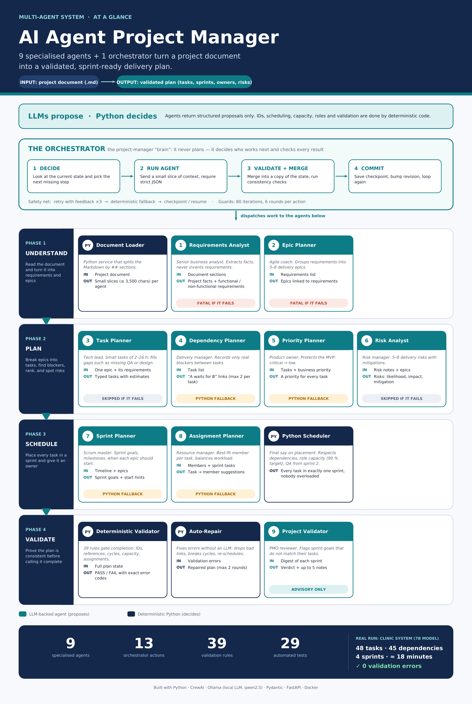

# Agents

Nine specialised agents. Each is a CrewAI persona (role, goal, backstory) with a prompt builder and a strict output schema. Delegation between agents is disabled; coordination happens only through the Orchestrator.

| # | Agent | Invoked in | If it fails |
|---|-------|-----------|-------------|
| 1 | Requirements Analyst | `analyze_project`, `extract_requirements` (x2) | Fatal |
| 2 | Epic Planner | `create_epics` | Fatal |
| 3 | Task Planner | `create_tasks` (per epic + gap mode) | Skipped; repair or gap-fill later |
| 4 | Dependency Planner | `create_dependencies` | Heuristic dependencies in Python |
| 5 | Priority Planner | `set_priorities` | Defaults from task-level priority |
| 6 | Risk Analyst | `detect_risks` | Skipped |
| 7 | Sprint Planner | `plan_sprints` | Python plans sprints with default goals |
| 8 | Team Assignment Planner | `assign_tasks` | Python assigns by least load |
| 9 | Project Validator | `semantic_review` | Skipped |

## 1. Requirements Analyst
- **Role:** senior business analyst; extracts facts and requirements, never invents any.
- **Modes:** *project* (summary, objective, duration in weeks, actors, MVP scope, out of scope, assumptions, business priority), *functional* (one item per capability), *non-functional + constraints*.
- **Input:** targeted document sections only.
- **Output:** `ProjectAnalysis` or `RequirementsOutput` (title up to 6-8 words, description up to 15 words, priority, kind).
- **Guardrails:** lists capped at 10 items; actors must be user roles.

## 2. Epic Planner
- **Role:** agile coach; groups requirements into a small set of coherent epics (foundation, features, quality, release).
- **Input:** project summary and the requirement IDs, titles and kinds.
- **Output:** `EpicsOutput` with 5 to `max_epics` (8) epics.
- **Guardrails:** every functional requirement must belong to at least one epic; `requirement_ids` may only come from the supplied list.

## 3. Task Planner
- **Role:** tech lead; breaks an epic into concrete, verifiable tasks with realistic estimates.
- **Modes:** *epic mode* (3 to 8 tasks per epic, each 2-16 h, with an hour budget derived from team capacity) and *gap mode* (adds 2-4 tasks for every task type the team can execute but the plan lacks, such as QA or design).
- **Output:** `TasksOutput`: title (starts with a verb), type (`backend`, `frontend`, `database`, `design`, `qa`, `devops`, `documentation`), description, hours, priority.
- **Guardrails:** no IDs in the output (Python assigns `TASK-NNN`).

## 4. Dependency Planner
- **Role:** delivery manager; records only dependencies that truly block work, and only between tasks.
- **Input:** compact task list `ID [type] title (epic)`.
- **Output:** `DependenciesOutput`: `task_id` cannot start until `depends_on` is finished, with a reason of up to 10 words.
- **Guardrails:** at most 2 dependencies per task in the prompt (setting `max_dependencies_per_task` = 3); typical blockers only; no cycles. Python rejects unknown IDs, self-dependencies, duplicates and cycles.
- **Fallback:** within each epic, a task depends on the last task of the nearest earlier stage in the order design, database, backend, frontend, QA.

## 5. Priority Planner
- **Role:** product owner; ranks tasks by business value and delivery risk to protect the MVP.
- **Output:** `PrioritiesOutput`: `critical`, `high`, `medium`, `low`.
- **Guardrails:** runs at most twice; leftovers get task-level defaults; priorities are recomputed after dependencies change.

## 6. Risk Analyst
- **Role:** risk manager for short MVP projects (schedule, integration, quality, scope).
- **Output:** `RisksOutput`: 5 to 8 risks with likelihood, impact, mitigation (up to 20 words) and linked epic IDs.

## 7. Sprint Planner
- **Role:** scrum master; foundation first, features next, hardening and release last.
- **Output:** `SprintPlanOutput`: a goal and milestone name per sprint and the sprint in which each epic should start.
- **Guardrails:** the agent only *suggests*. The Python scheduler places every task.

## 8. Team Assignment Planner
- **Role:** resource manager; best-fit member per task by role and skills, balancing workload.
- **Called only** when a task's role has more than one eligible member; otherwise assignment is purely deterministic and costs no LLM call.
- **Output:** `AssignmentsOutput`: `task_id -> member_id`. A suggestion is honoured only if the role matches, capacity remains and the load stays balanced.

## 9. Project Validator
- **Role:** PMO reviewer; spots semantic problems structural checks cannot see (sprint goals that do not match tasks, missing important work).
- **Output:** `SemanticReview`: verdict (`pass` or `concerns`) and up to 5 notes.
- **Advisory only:** it can add notes but never overrides the deterministic validator.

## Deterministic Python components

| Component | What it does |
|-----------|--------------|
| Sprint scheduler | Places each task in exactly one sprint by priority rank; never before the sprint of a blocking task; per-role capacity with a 90 % target (fallback 100 %); soft per-sprint total (average x 1.15); QA not before sprint 2 |
| Task assigner | Accepts an agent suggestion only if role, capacity and balance allow; otherwise least-loaded eligible member |
| Validator | 39 rule codes, see [validation.md](validation.md) |
| Repair | Fixes common validation errors without an LLM |

Task type to role: backend and database -> Backend Developer; frontend -> Frontend Developer; design -> UI/UX Designer; qa -> QA Engineer; devops -> DevOps Engineer; documentation -> Project Manager.
