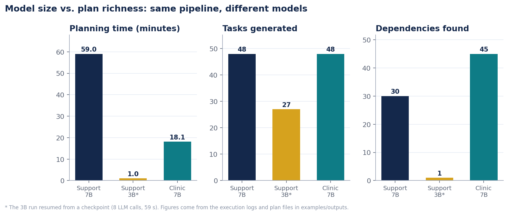
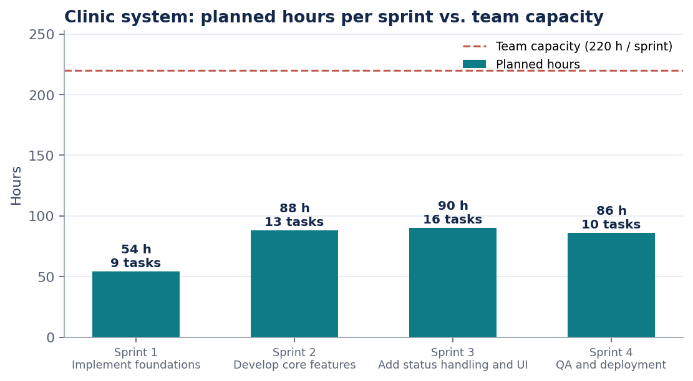
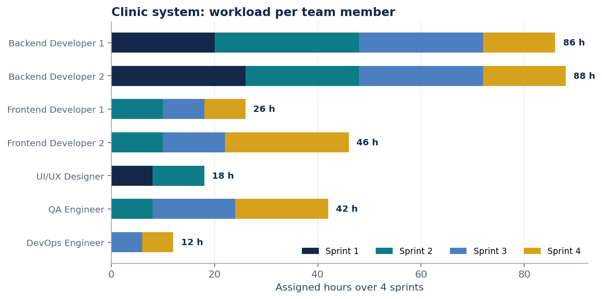
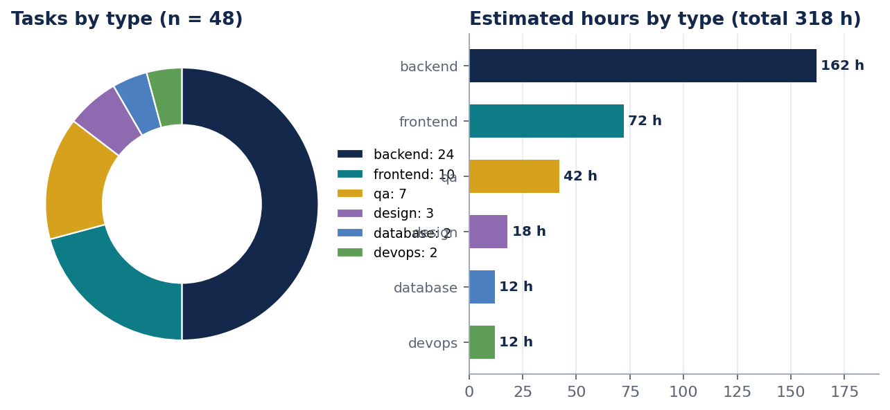
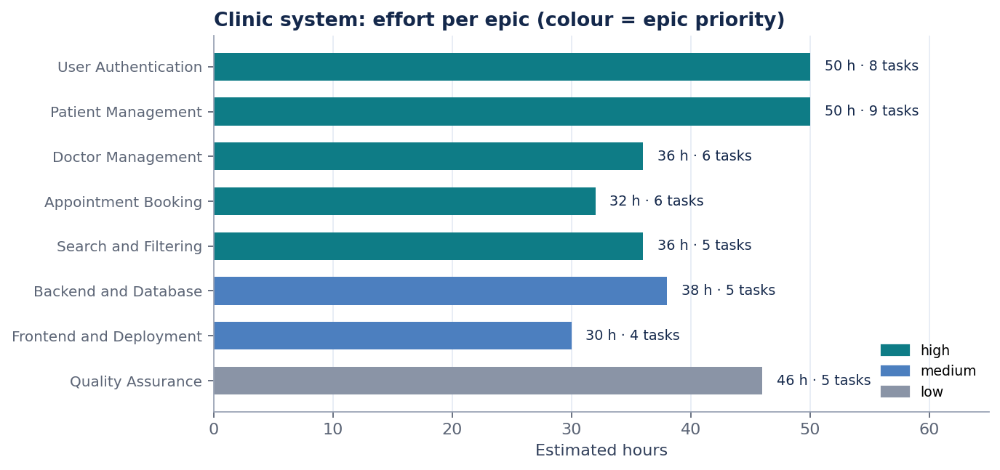
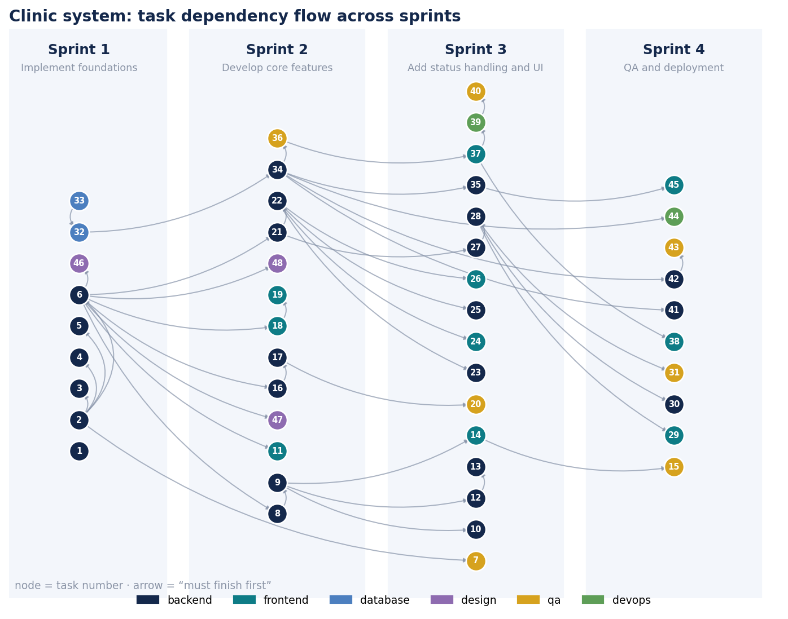
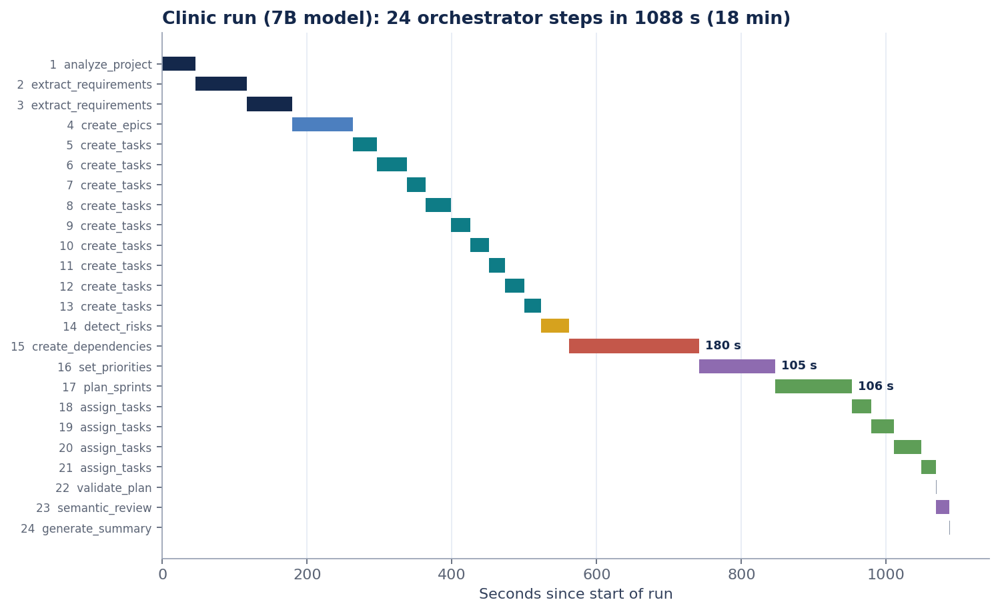

# Results

Two sample projects were planned. All figures come from the execution logs and plan files in `examples/outputs/`.

| | Support platform, 7B | Support platform, 3B | Clinic system, 7B |
|---|---|---|---|
| Model | `qwen2.5:7b-instruct` | `qwen2.5:3b` (resumed from checkpoint) | `qwen2.5:7b` |
| Duration | 3,542 s (about 59 min) | 59 s | 1,088 s (about 18 min) |
| LLM calls / steps | 24 / 24 | 8 / 10 | 24 / 24 |
| Tasks, hours | 48, 344 h | 27, 166 h | 48, 318 h |
| Dependencies | 30 | 1 | 45 |
| Validation | pass, 0 errors, 3 warnings | pass, 0 errors, 0 warnings | pass, 0 errors, 4 warnings |
| Semantic review | concerns (4 notes) | concerns (4 notes) | concerns (3 notes) |

The 7B support-platform run is represented in the repository only by its execution log (`examples/outputs/support_platform_7b_execution_log.json`); its task and hour totals were derived from the sprint summary in that log.

## Clinic Appointment & Patient Management System

Source: `examples/inputs/clinic_project.md` (4-week MVP). Generated plan: 35 requirements, 8 epics, 48 tasks, 45 dependencies, 5 risks, 4 sprints, 4 milestones.

| Sprint | Goal | Tasks | Planned h / capacity |
|--------|------|-------|----------------------|
| 1 | Implement foundations | 9 | 54 / 220 |
| 2 | Develop core features | 13 | 88 / 220 |
| 3 | Add status handling and UI | 16 | 90 / 220 |
| 4 | QA and deployment | 10 | 86 / 220 |

## Observations

- **Model size matters for relational reasoning:** 30 dependencies (7B) versus 1 (3B) on the same document.
- **Dependency analysis is the slowest step on 7B:** about 860 s in the 7B support run (two 300 s timeouts before success) and about 180 s in the clinic run.
- **Self-healing:** in the clinic run the Sprint Planner returned invalid JSON twice; the rejection reason was fed back and the third attempt was accepted.
- **Validation:** all runs ended with 0 errors. The clinic warnings are `REQUIREMENT_UNCOVERED`.

## Caveats

- The semantic reviewer reported "concerns" on all runs (for example sprint goals judged too broad). It is advisory.
- Plans use about 36 % (clinic) and 19-39 % (support) of the 880 h available across four sprints, so estimates may be optimistic or the team under-used.
- In the clinic plan the milestones are named only `M1` to `M4`.
- The Project Manager role receives almost no tasks (documentation tasks only).
